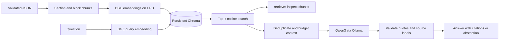

# Local AWS Documentation RAG

A local retrieval-augmented generation pipeline over an AWS documentation
snapshot, built with Python, LangChain integrations, BGE, Chroma and Ollama.
Inspect retrieved chunks independently, generate answers with source citations,
and measure retrieval separately from generation. No commercial API keys or
AWS account required. This runs locally; it is not deployed on AWS.

## Architecture



| Component | Implementation |
| --- | --- |
| Input | 10 English schema-1.0 JSON documents; 83 nonempty sections |
| Chunking | Preserve sections and blocks; 440-token limit; 40-token overlap when splitting oversized prose |
| Tables | Atomic rows with real column labels |
| Embeddings | `BAAI/bge-small-en-v1.5`, CPU, normalized vectors |
| Vector store | Persistent Chroma; cosine distance; default top-k = 4 |
| Context | Deduplicated complete chunks; conservative 3,000-byte UTF-8 budget |
| Generator | Ollama `qwen3:1.7b`; temperature 0; JSON output |
| Citations | Source path, JSON Pointer, character offsets and verbatim quote |
| Persistence | SHA-256 source hashes, deterministic chunk IDs, configuration signature, atomic manifest and advisory locking |

Retrieval is **dense vector search**, without BM25, hybrid retrieval or reranking.
The recorded baseline index contains 96 chunks.

## Quick start

Requirements: **Linux or WSL**, Python **3.10**, [uv](https://docs.astral.sh/uv/)
and [Ollama](https://docs.ollama.com/quickstart). Run from the repository root.
Linux advisory locks are required; native Windows is not supported. No GPU is
required.

```bash
uv sync --locked
cp .env.example .env  # first installation only; preserve an existing .env
```

Start Ollama in a separate terminal if it is not already running:

```bash
ollama serve
```

Then prepare the models and index:

```bash
ollama pull qwen3:1.7b
uv run python -m aws_rag inspect --source-dir data
uv run python -m aws_rag ingest --source-dir data
```

Initial setup downloads dependencies, BGE weights and the Ollama model.
Inference subsequently uses local weights. State defaults to `.rag_state/`;
`RAG_STATE_DIR` can point outside the checkout. Configuration comes from
defaults, `.env`, then environment variables; see [.env.example](.env.example).
Do not commit weights, caches or the generated index.

## Inspect retrieval and generate an answer

```bash
uv run python -m aws_rag retrieve "How can S3 Versioning help recover objects?" --top-k 4
uv run python -m aws_rag retrieve "How can S3 Versioning help recover objects?" --top-k 8 --json
uv run python -m aws_rag ask "How can S3 Versioning help recover objects?"
uv run python -m aws_rag ask "How can S3 Versioning help recover objects?" --json
```

`retrieve` shows full chunk text, source and cosine distance (lower means closer).
It uses BGE and Chroma without calling Ollama. These are raw top-k hits before
context deduplication and filtering.

See the [recorded demo](docs/demo.md) for actual evidence and model output.
To save a fresh demo with chunks, context, answer and citations:

```bash
uv run python scripts/demo.py --output demo.json
```

The demo needs an ingested index and a running Ollama server. Output may vary
across model builds and hardware; the recorded example is an observed run.

## Evaluation and tests

```bash
# Unit tests: no model dependencies or downloads; skips unavailable Chroma:
PYTHONPATH=src python3 -m unittest discover -s tests -v

# Includes real Chroma integration with deterministic test vectors:
uv run python -m unittest discover -s tests -v
uv run python -m aws_rag evaluate --validate-only

# Real BGE retrieval, no LLM:
uv run python scripts/evaluate_retrieval.py

# Full retrieval and generation; start Ollama first:
uv run python -m aws_rag evaluate
```

[GitHub Actions](.github/workflows/ci.yml) runs unit tests, real Chroma integration,
reference validation and package building without model downloads. The workflow
runs after pushing to GitHub; local verification is not a hosted CI result.

The dataset has 23 questions: 20 answerable and 3 outside coverage, split into
17 development and 6 holdout questions. References identify actual source
locations. An implementation agent authored the questions; this small dataset
is not an independent benchmark. Holdout results are separate; future tuning
on these inspected questions must not be described as unseen evaluation.

Recorded retrieval: **Recall@4 = 1.00**, **MRR@4 = 0.925**, measured at section
level on the 20 answerable questions. These do not measure answer accuracy or
establish generalization. See the [evaluation report](reports/evaluation_baseline.md)
and [retrieval artifact](reports/retrieval_evaluation.json).

The full generation run produced **10/20 false abstentions**, **3/3 correct
out-of-coverage abstentions**, and **7/20 strictly correct, grounded answers**
under the documented agent review rubric. Generation remains the main limitation.
All raw drafts and review labels are in the [generation artifact](reports/generation_evaluation.json).

Full evaluation checkpoints each question in
`RAG_STATE_DIR/evaluation_progress.json`, saves the raw final artifact in
`RAG_STATE_DIR/evaluation_results.json`, exports a portable
`reports/evaluation_baseline.json`, and overwrites
`reports/evaluation_baseline.md`. Preserve recorded results before rerunning.
Accuracy and claim grounding require explicit review; automatic quote checks
alone do not establish them.

## Index lifecycle

Run `ingest` after changing documents. Unchanged ingestion computes no vectors;
updates reuse unchanged vectors. Deleted documents disappear from the new
collection. `ingest --force` recomputes all vectors. Queries reject stale,
incompatible or incomplete indexes; they never ingest implicitly.

Updates populate a new collection and atomically publish its manifest before
removing the prior owned collection. Interrupted updates retain the previous
manifest; unreferenced collections can remain for diagnosis. Unrelated
collections are preserved. Queries, ingestion and evaluation share an exclusive
lock: do not run them concurrently against the same state directory.

## Limitations

- A small, fixed AWS documentation snapshot, not current operational guidance.
- Quote validation does not prove every generated claim is grounded.
- Relevant evidence can be retrieved while generation abstains or fails validation.
- Conservative context filtering can discard retrieved hits.
- No web UI, authentication, multi-user service or cloud deployment.
- Default embedding revision `main` is mutable. Pin an immutable model commit
  before starting a new reproducibility study.
- Original Markdown normalization has known warnings; provenance is preserved.

## Repository layout

```text
src/aws_rag/       ingestion, retrieval, generation and evaluation
scripts/          demo, retrieval evaluation and optional local launcher
tests/            unit and real Chroma integration tests
data/normalized/  validated input documents
evaluation/       questions and reference excerpts
reports/          recorded metrics, outputs and review
docs/             demo and portfolio description
```

Other files in `data/` preserve the supplied archive and provenance; only
`normalized/` is indexed. Third-party documentation retains its supplied source,
attribution and license metadata; no ownership of AWS documentation is claimed.
See [corpus analysis](reports/corpus_analysis.md) for extraction decisions.

`scripts/local.py` is an optional offline launcher for an already provisioned
runtime under `RAG_STATE_DIR` (`venv/`, `tools/uv`, `tools/ollama/`); it does not
install that runtime. Fresh checkouts should use the quick start above.
Historical installation notes are in [the download audit](reports/download_audit.md).
